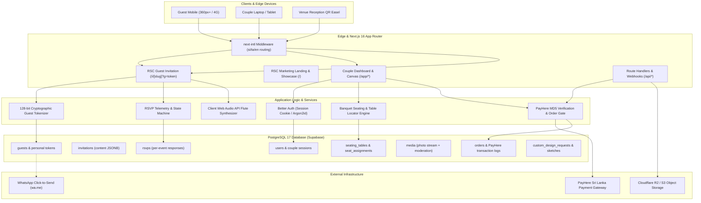
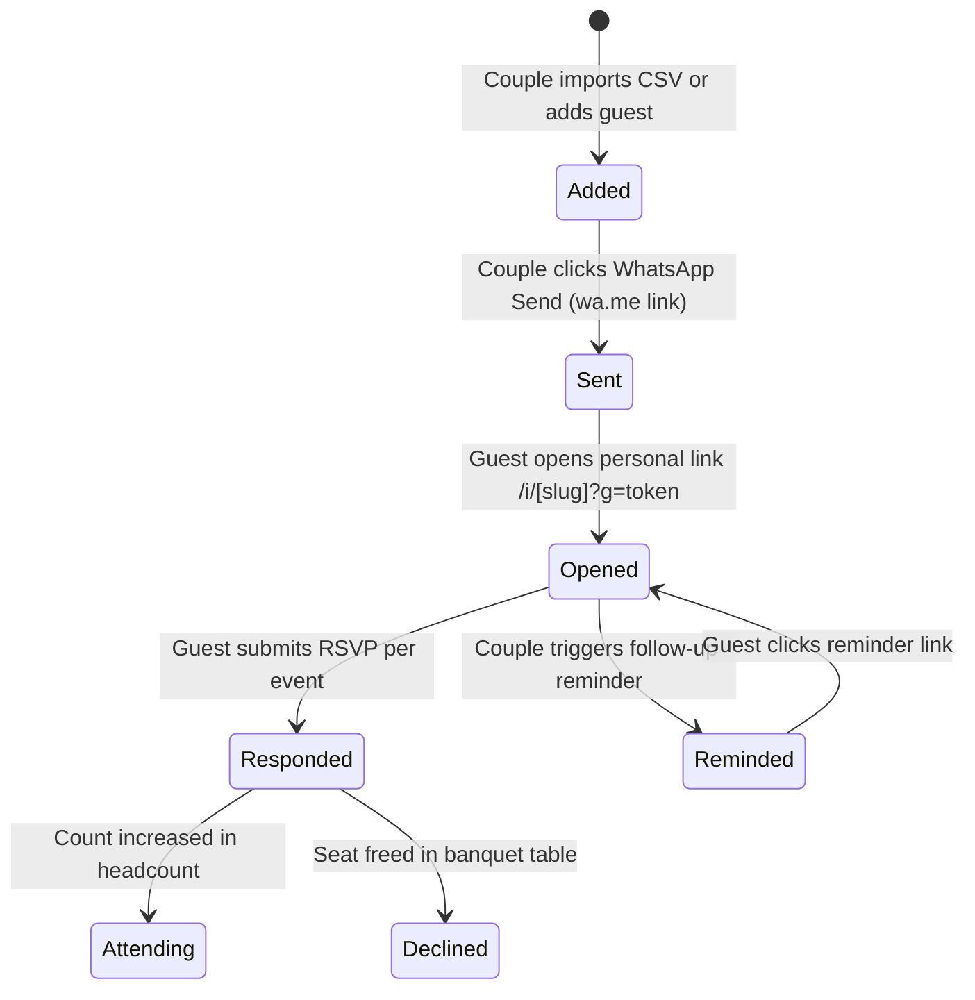

# System Architecture & Technical Specification

> **Product**: Digital Wedding Invitation Platform for Sri Lankan Couples  
> **Domain**: Traditional Poruwa, Kandyan Heritage, Church, Muhurtham & Nikah Celebrations  
> **Languages**: Sinhala (`si`), Tamil (`ta`), English (`en`)  
> **Architecture Standard**: Next.js 16 App Router, React Server Components (RSC), TypeScript Strict, Drizzle ORM + PostgreSQL 17

---

## 1. High-Level System Architecture

The platform is designed around a zero-compromise separation between **Server-Rendered Marketing/Public Invitations** and **Client-Side Interactive Studio Tools** (Live Editor, Seating Canvas, Moderation Stream, and Audio Synthesizer).



---

## 2. Technology Stack & Decision Matrix

| Layer | Technology | Decision Rationale & Constraints |
|---|---|---|
| **Framework** | Next.js 16 (App Router) | Native React Server Components for near-zero guest JS bundle, View Transitions, Server Actions for mutations. |
| **Language** | TypeScript 5.8 (Strict) | Zero `any` policy. Complete schema derivation between DB models and UI contracts. |
| **Styling** | Tailwind CSS v4 + OKLCH Tokens | Native CSS tokens in `styles/tokens.css`. High-gamut OKLCH color space for authentic gold and crimson inks. |
| **Icons** | Lucide Icons | Strictly tree-shaken per component. 1.5 stroke width, 16px/20px/24px sizes. |
| **Database** | PostgreSQL 17 (Supabase) | ACID compliance, row-level security (RLS), JSONB indexing for flexible cultural invitation schemas. |
| **ORM** | Drizzle ORM | Zero-overhead type-safe query builder, direct SQL generation, minimal bundle weight compared to Prisma. |
| **Auth** | Better Auth / Cookie Sessions | HttpOnly, SameSite=Lax, Secure session tokens. Owner-scoped query isolation. |
| **Payments** | PayHere Sri Lanka | Domestic LKR payments (Cards, eZ Cash, mCash, Genie, Sampath Vishwa). Server-side MD5 signature hash validation. |
| **Internationalization** | `next-intl` | Tri-lingual routing (`/si`, `/ta`, `/en`). High typographic care for Sinhala and Tamil rendering. |
| **Audio Synthesis** | Native Web Audio API | Zero MP3 asset loading (< 50 lines of code). Pure oscillator & gain envelope synthesis for ceremonial wedding flute melodies. |
| **Testing** | Vitest + Playwright | 18 unit tests for crypto/validation helpers; 87 Playwright E2E tests across 3 screen sizes (360px, 768px, 1280px) and 2 languages. |

---

## 3. Server vs. Client Component Boundaries

To guarantee the **< 150 KB gzipped guest budget**, interactive client components are strictly encapsulated:

```
app/[locale]/
├── page.tsx                     (RSC: Landing page composed of server sections)
├── (auth)/
│   └── login/page.tsx           (RSC: Static auth layout)
│       └── login-form.tsx       (Client: Form validation & credential submission)
├── app/
│   └── invitations/
│       ├── [id]/edit/page.tsx   (RSC: Data pre-fetch scoped to owner)
│       │   └── live-editor.tsx  (Client: Split form & live mobile preview)
│       ├── [id]/seating/        (Client: Drag-and-drop banquet seating arrangement)
│       ├── [id]/gallery/        (Client: Live photo upload & couple moderation stream)
│       └── [id]/reminders/      (Client: WhatsApp delivery telemetry & 1-click reminders)
└── i/[slug]/page.tsx            (RSC: Guest shell rendered in < 500ms)
    ├── template-renderer.tsx    (Client: Audio player toggle, dock navigation, RSVP modal)
    └── wedding-music-player.tsx (Client: Web Audio API synthesis oscillator)
```

---

## 4. Multi-Tenant Data Isolation & Security

### 4.1 Row-Level Isolation
Every database mutation in the couple studio is strictly scoped by the authenticated user's `userId`.
- Invitations query: `db.select().from(invitations).where(and(eq(invitations.id, id), eq(invitations.userId, currentUserId)))`
- Guests query: Filtered via an inner join ensuring the target guest belongs to an invitation owned by the session caller.
- Cross-tenant intrusion tests in `tests/e2e/auth.spec.ts` assert that couples cannot read or mutate invitations belonging to another account.

### 4.2 128-Bit Cryptographic Guest Tokens
Guest personal links are formatted as:
$$\text{https://domain.lk/i/}[\text{slug}]\mathbf{?g=}[\text{token}]$$
- Tokens are generated using `crypto.randomBytes(16).toString("hex")` (128 bits of entropy).
- Prevents enumeration attacks: A third party cannot guess other guests' names, table numbers, or dietary requirements.
- Token revocation: Couples can regenerate or delete tokens at any time from their guest management dashboard.

---

## 5. WhatsApp Delivery & RSVP State Machine



### Key Workflow Principles:
1. **No Group Chats**: Invitations are sent individually via personalized `https://wa.me/{phone}?text={encodedMessage}` links.
2. **First-Open Telemetry**: The first time the `/i/[slug]?g=[token]` route loads, the system automatically marks the guest as `opened_at = NOW()` and increments `open_count`.
3. **Automated Reminders**: Guests who remain in `sent` or `opened` without an RSVP can be filtered in 1 click and messaged with custom Sinhala/English reminder copy.

---

## 6. PayHere Payment Gateway & MD5 Security

The publishing checkout flow is gated by PayHere Sri Lanka:

1. **Client Checkout**: Couple selects tier (Essential: Rs. 2,900, Complete: Rs. 4,900, Signature: Rs. 8,900).
2. **Order Generation**: Server action inserts an order in `orders` with `status = 'pending'`.
3. **PayHere Signature**:
   $$\text{hash} = \text{MD5}(\text{merchant\_id} + \text{order\_id} + \text{amount} + \text{currency} + \text{MD5}(\text{merchant\_secret}))$$
4. **Idempotent Webhook Verification**:
   - Webhook at `/api/webhooks/payhere` computes the local MD5 signature using the secret key.
   - If signatures match and `status_code === '2'` (Success), the invitation's `isPublished` flag is toggled to `true`.
   - Idempotency is enforced: Duplicate IPN notices are acknowledged with `200 OK` without creating duplicate publish events.

---

## 7. Web Audio API Ceremonial Flute Synthesizer

Rather than burdening guest mobile bandwidth with heavy MP3 audio assets (~3–8 MB), the platform utilizes a lightweight procedural synthesizer:

```typescript
// Auspicious Sri Lankan pentatonic flute scale (Sa, Ri, Ga, Pa, Dha)
const FREQUENCIES = [440.00, 493.88, 554.37, 659.25, 739.99]; // A4, B4, C#5, E5, F#5

function playNote(audioCtx: AudioContext, freq: number, startTime: number, duration: number) {
  const osc = audioCtx.createOscillator();
  const gain = audioCtx.createGain();

  osc.type = "sine";
  osc.frequency.setValueAtTime(freq, startTime);

  // Soft attack, warm sustain, gentle release
  gain.gain.setValueAtTime(0.0001, startTime);
  gain.gain.exponentialRampToValueAtTime(0.2, startTime + 0.15);
  gain.gain.exponentialRampToValueAtTime(0.0001, startTime + duration);

  osc.connect(gain);
  gain.connect(audioCtx.destination);

  osc.start(startTime);
  osc.stop(startTime + duration);
}
```

- **Bundle Size**: Under 2 KB of JavaScript.
- **Latency**: Instant playback without network buffering.
- **Offline Capable**: Works even if guest connectivity drops after initial page load.

---

## 8. Compliance & Sri Lanka PDPA (No. 9 of 2022)

- **Data Minimization**: Only stores guest names, phone numbers, RSVP counts, and dietary requirements.
- **Data Subject Rights**: Couples can export all guest data to CSV or execute an atomic purge of the entire invitation dataset upon completion of the wedding celebrations.
- **Retention**: Guest tokens automatically expire 90 days after the final wedding event date.
